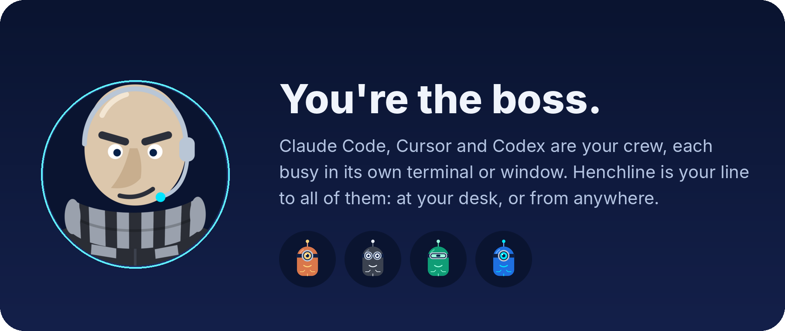
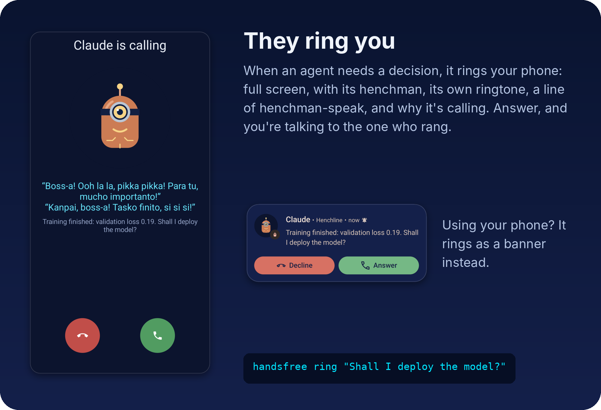
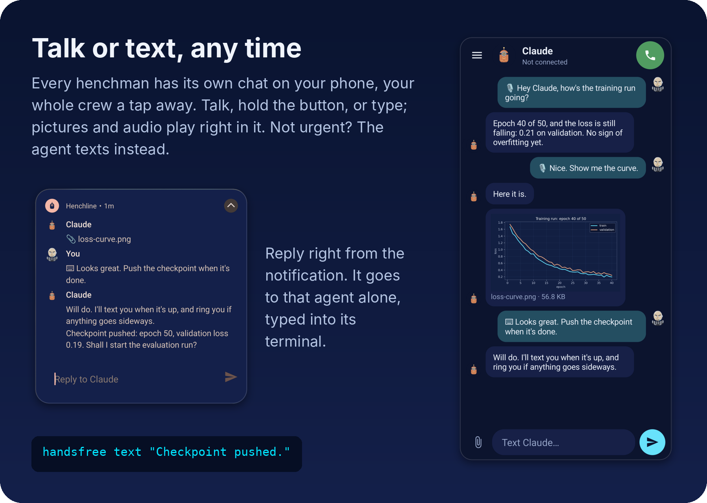
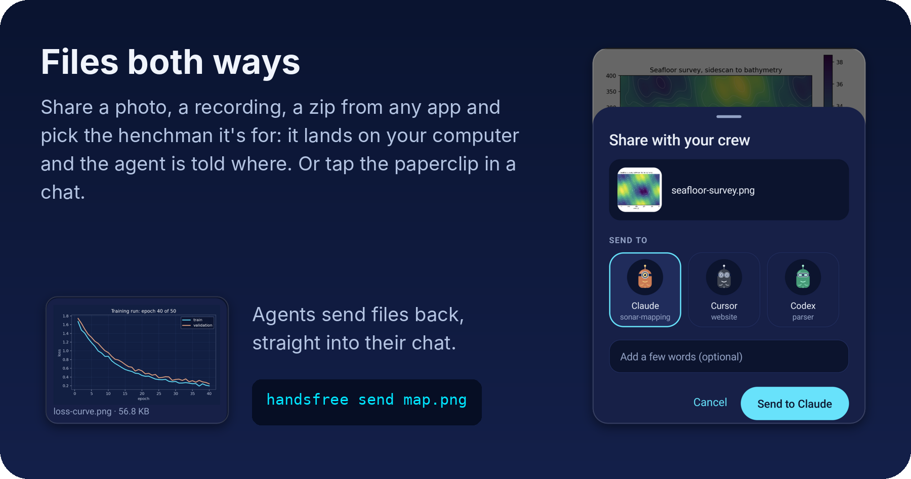

<h1 align="center"></h1>

<p align="center"></p>

Talk to them at your desk without touching the keyboard, call them from your phone when you're out, and let them ring or text you when they need a decision. Every henchman has its own voice, its own ringtone, its own chat. And it all runs on your own machine.

<p align="center">



</p>

## What it does

**At your desk**

- 🎙 **Push-to-talk.** Hold the Copilot key (or any key), speak, let go: Whisper writes it down on your machine and it is typed into the agent you're looking at. A word you stress arrives as `*word*`; a tone that stands out arrives as `[tone: loud, fast]`, so the agent knows how you said it.
- 🔊 **They talk back.** Each agent speaks its replies aloud in its own voice (Claude, Cursor and Codex sound different), one at a time, never over each other, and goes quiet the moment you start talking.
- 🙌 **Hands-free.** Say *"hey Claude"* (your own trained wake word) or tap your earbuds. Answer right after they speak, no wake word needed. Talk over a reply to cut it off. *"Over"* sends at once, *"give me a minute"* keeps listening.
- 🔀 **Switch by voice.** *"Switch me to Cursor"*, *"hand it back to Claude"*, *"send that to Codex"*: fixed phrases, announced out loud, so a mishearing is undone with *"back to …"*.

**Away from it: the Henchline app**

- 📞 **Call your crew** over your own Tailscale network. Your computer stays quiet; your phone is its mic and speaker. Open line, hold-to-talk, or typed; your words show in the chat exactly as they were heard.
- 🔔 **They ring you.** `handsfree ring "the build finished, want me to deploy?"` rings your phone: full screen when it's locked, a ringing banner while you use it, with the henchman's own tone and phrase (hear [Claude](call/android/app/src/main/res/raw/banner_claude.wav), [Cursor](call/android/app/src/main/res/raw/banner_cursor.wav) and [Codex](call/android/app/src/main/res/raw/banner_codex.wav): the sound files open on GitHub with a play button). Answer, and you're talking to the one who rang. The agent learns whether you answered, declined, missed it, or were out of reach. Your own agents get through Do Not Disturb; nobody else does.
- 💬 **They text you.** `handsfree text "tests are green"`: a message with a reply box. Your reply is typed into that agent's terminal, and only that one's. Start a text from any agent's chat in the app, too.
- 📎 **Files both ways.** Share a photo, a voice memo, a zip, a video from any app, or tap the paperclip: it lands on your computer and the agent is told where. An agent runs `handsfree send report.pdf "here you go"` and it shows in its chat.
- 🗂 **A chat per henchman**, kept on the phone, your terminal conversation mirrored into it during a call.
- 🎧 **Earbuds as push-to-talk**: tap to talk, tap to send, the phone stays in your pocket. Talk/Send and Hang up on the lock screen, and a Quick Settings tile if you want one.

**For your agents**

One snippet (`agents/AGENTS-snippet.md`) teaches every agent (Claude Code, Cursor, Codex) how to speak, how your voice messages are tagged, and when to ring, text or send you something. Nothing to install inside the agents: Henchline types into their own terminal tabs and windows.

## Yours, and only yours

- **Local.** Whisper hears you and Kokoro speaks, on your machine. No cloud speech, no relay, no account.
- **Your network.** The phone reaches your computer over your own Tailscale; only your devices can.
- **Any agent.** Not tied to one vendor: if it runs in a terminal or in Cursor, it's on the crew.
- **Your voice stays yours.** Record the henchman phrases in your own voice; they stay on your phone, never in the repository.
- **Careful by default.** Rings and replies use one-time secret addresses; secrets in what you type are masked before they reach the phone; a text goes to exactly the agent you texted.

## What is in here

Every folder has its own README with the details. Each piece is laid out the same way: its command at the top,
its modules in `core/`, its tools in `tools/`, and what gets installed into the system (units, configs) in `system/`.

| Folder | What it does | Needs |
|---|---|---|
| [`ptt/`](ptt/) | **Push-to-talk:** hold a key, speak, the words are typed into the focused window. `ptt.py`; `core/` the hotkey, the paste and the tray icon; `system/` the unit and an example config. | nothing else |
| [`talkback/`](talkback/) | **Talkback:** the agents speak their replies through a local voice, one at a time. `scripts/` the `talkback` command and its worker; `SKILL.md` what agents read. | `ptt/` only to go quiet while you talk |
| [`handsfree/`](handsfree/) | **Hands-free:** talk with the agents without a key. `handsfree.py`; `core/` listening, turns, routing, the wake words, talking over; `tools/` recording, training and benchmarks; `system/` the units and the echo canceller. | `talkback/` |
| [`call/`](call/) | **Phone call and Henchline:** the call server and page; `hooks/` the Claude Code terminal mirror; `system/` the unit; [`android/`](call/android/) the app. | `handsfree/`, Tailscale |
| [`agents/`](agents/) | What the agents are told: one snippet for Claude Code, Cursor, Codex and anything reading `AGENTS.md`. | `talkback/` |
| [`voice/`](voice/) | What all of them share: the state files (`state.py`), agents and their tabs (`agents.py`), talkback's queue (`spool.py`), files to and from the phone (`files.py`); `desktop/` windows, keys, the clipboard and terminals (KDE or any X11); `speech/` Whisper and tone marks. | nothing |
| [`tests/`](tests/) | Unit tests per piece, and a throwaway-container test of the generic X11 desktop. | |
| [`docs/`](docs/) | The README's pictures and the scripts that draw them. | |

## Desktops

KDE Plasma on X11, or any other X11 desktop; everything the tools need from the desktop goes through one small interface, so Wayland is a module away (pull requests welcome). More: [voice/README.md](voice/README.md).

## Requirements

- Linux, X11
- PipeWire (`pw-record`, `pw-play`)
- KDE Klipper (`qdbus org.kde.klipper`)
- Python 3.12 (the system one; the venv borrows only PyQt5 and evdev from apt)
- Your user in the `input` group

While the laptop is plugged in, Whisper small stays on the GPU. On battery it runs on the CPU, so a CUDA context is not held and the GPU can sleep. The microphone is not opened until the key is down.

## Install

```bash
git clone https://github.com/NinjaTuna007/henchline
cd henchline
sudo apt install python3-venv python3-pyqt5 python3-evdev curl
./install.sh ptt          # or: talkback, handsfree, agents, all
```

Each piece installs on its own and only what it needs. Python packages go into one private venv, `~/.local/share/henchline/venv` (its path is written in each script's first line, since a shebang cannot read a setting, and in `voice/state.py`), so nothing in the system or your own Python changes, and nothing there can break these tools; `requirements/` lists them per piece (the CUDA libraries only when `nvidia-smi` exists). `./doctor.py [piece]` checks each piece and prints the command that fixes whatever is missing (it runs on the system Python, so it works when the venv is the problem). `./install.sh remove <piece>` takes a piece out again and leaves settings, voice models and wake-word recordings in place. The first start downloads the Whisper small weights. The user service starts again at graphical login.

## Push-to-talk

Hold the Copilot key (or any key you choose), speak, let go: Whisper writes it down on your machine and it is typed into the window in front, with Enter. A stressed word arrives as `*word*`, an unusual tone as `[tone: loud, fast]`. Right-click the tray icon for language, power and the hotkey. More: [ptt/README.md](ptt/README.md).

## Talkback



Your agents speak their replies aloud, each in its own voice, one at a time, through Kokoro on your machine. They go quiet the moment you start talking. One snippet teaches every agent when and how to speak. More: [talkback/README.md](talkback/README.md).

<br clear="right">

## Hands-free


Talk to your agents without touching a key. Answer right after they speak; say *"hey Claude"* (your own trained wake word) or tap your earbuds the rest of the time. Talk over a reply to cut it off; *"over"* sends at once, *"give me a minute"* keeps listening, *"switch me to Cursor"* hands you over, announced out loud. An echo canceller keeps it from hearing itself. More: [handsfree/README.md](handsfree/README.md).

<br clear="left">

## Phone call


The same conversation from your phone, over your own Tailscale network: `./install.sh call` runs a small server only your devices can reach. Your phone becomes the mic and speaker; the computer stays quiet. Open line, hold-to-talk or typed, a chat per agent, and switching by voice as at your desk. More: [call/README.md](call/README.md).

<br clear="right">

### Henchline, the Android app


The call as a real app (Android 10+): it keeps going with the screen off, rings full screen with each henchman's own tone, takes texts you reply to from the notification, carries files both ways, keeps a chat per agent, and turns your earbuds into push-to-talk. Build it with `./gradlew assembleDebug` in `call/android/` and install over USB. More: [call/android/README.md](call/android/README.md).

<br clear="left">

## License

MIT
