# Henchline

<p align="center"></p>

**Talk to all your AI henchmen: by voice, by phone, by text.**

You're the boss. Claude Code, Cursor and Codex are your crew, each busy in its own terminal or window. Henchline is the line to all of them, at your desk or from anywhere:

- **At your desk:** hold a key and speak, or just say "hey Claude". They answer out loud, each in its own voice, one at a time. Talk over them to cut in; say "switch me to Cursor" to hand the conversation over.
- **Away from it:** call your crew from your phone with the Henchline app, as you would a person. Each henchman has its own chat; your words show as they were heard.
- **When they need you:** an agent rings your phone, full screen, with its own ringtone and a line of henchman-speak. Not urgent? It texts you instead, and you reply from the notification; the reply is typed into that agent's terminal, and only that one's.
- **Files both ways:** share a photo, a recording, a zip from any app on your phone (or tap the paperclip in a chat) and the agent is told where it landed; an agent sends you a picture or a document and it shows in its chat.

It works with any agent that runs in a terminal or in Cursor: Henchline types into their own tabs and windows, so there is nothing to install inside them, and it was never built for one vendor. Everything runs on your own machine: Whisper hears you and Kokoro speaks, locally; your phone reaches the laptop over your own Tailscale network. No cloud speech, no relay, no account.

### How it compares

Pieces of this exist elsewhere: each vendor's own remote control (Claude Code's Remote Control and Channels, Codex in the ChatGPT app, Cursor's iOS app) works with its own agent through its cloud; [Happy](https://github.com/slopus/happy) and Omnara are phone apps for Claude Code and Codex with cloud voice; [CallMe](https://github.com/ZeframLou/call-me) and [Better Call Claude](https://github.com/sns45/better-call-claude) let Claude Code phone you through Twilio; [TalkiTo](https://github.com/robdmac/talkito) gives Claude Code and Codex a voice and Slack/WhatsApp chat; [VoiceMode](https://github.com/mbailey/voicemode) gives one agent local two-way voice. As far as a search in November 2026 found, none puts several agents, hands-free conversation with spoken handoff, and your own calling, ringing and texting app together, locally. If you know one that does, please open an issue.

It began as **copilot-ptt**, a push-to-talk key, which it still is: see [Push-to-talk](#push-to-talk).

## What is in here

| Folder | What it does | Needs |
|---|---|---|
| `ptt/` | **Push-to-talk:** hold a key, speak, the words are typed into the focused window (`keys.py` the hotkey, `paste.py` the window, `tray.py` the icon, `ptt.py` records in between). Works on its own. | the rest of this page |
| `talkback/` | **Talkback:** AI agents (Claude Code, Cursor) speak their replies through a local voice, one at a time. | `ptt/` only if you want it to go quiet while you talk |
| `handsfree/` | **Hands-free:** talk with those agents without touching a key: a reply window after they speak, talking over them, and a personal wake word. | `ptt/` and `talkback/` |
| `call/` | **Phone call:** the same conversation from your phone, over Tailscale: a web page streams your mic in and the agents' voices out, with a hold-to-talk button and a chat. | `handsfree/`, Tailscale on the laptop and the phone |
| `agents/` | What the agents need to be told: one snippet for Claude Code, Cursor, Codex and anything reading `AGENTS.md`. | `talkback/` |
| `voice/` | What the three share: the state files in `~/.local/state/ptt/` and their names (`state.py`), the settings, Whisper and the chime (`whisper.py`), tone marks (`tone.py`), talkback's queue of clips (`spool.py`), which agent and terminal tab a process belongs to (`agents.py`), windows, keys and the clipboard on X11 (`x11.py`). | nothing |

## Desktops

Everything the tools need from the desktop (the focused window, raising a window, keys, the clipboard, typing into a terminal tab) goes through one interface, `voice/desktop.py`. Two implementations exist:

- **KDE Plasma on X11** (`voice/kde_x11.py`): Klipper for the clipboard, Konsole's D-Bus interface for terminal tabs.
- **Any other X11 desktop** (`voice/generic_x11.py`): `xclip` for the clipboard; any terminal that sets `WINDOWID` and pastes with Ctrl+Shift+V (most do; plain xterm needs `XTerm*VT100.translations: #override Shift Ctrl <Key>V: insert-selection(CLIPBOARD)`, as the test sets). Hands-free raises the terminal, checks it really is in front, pastes and presses Enter.

`tests/generic_x11/run.sh` proves the second one without touching your system: a throwaway Fedora container with a virtual screen, the Openbox window manager and two xterms, one running a pretend agent; it checks window lookup, focus, the clipboard, finding an agent's tab and typing a line into it (10 checks). It found two bugs that this laptop's KDE setup hid.

Wayland is not implemented: a new module filling in the same interface is the way in, and pull requests are welcome.

## Requirements

- Linux, X11
- PipeWire (`pw-record`, `pw-play`)
- KDE Klipper (`qdbus org.kde.klipper`)
- Python 3.12 (the system one; the venv borrows only PyQt5 and evdev from apt)
- Your user in the `input` group

While the laptop is plugged in, Whisper small stays on the GPU. On battery it runs on the CPU, so a CUDA context is not held and the GPU can sleep. The microphone is not opened until the key is down.

## Install

```bash
git clone https://github.com/NinjaTuna007/henchline
cd henchline
sudo apt install python3-venv python3-pyqt5 python3-evdev curl
./install.sh ptt          # or: talkback, handsfree, agents, all
```

Each piece installs on its own and only what it needs. Python packages go into one private venv, `~/.local/share/copilot-ptt/venv` (its path is written in each script's first line, since a shebang cannot read a setting, and in `voice/state.py`), so nothing in the system or your own Python changes, and nothing there can break these tools; `requirements/` lists them per piece (the CUDA libraries only when `nvidia-smi` exists). `./doctor.py [piece]` checks each piece and prints the command that fixes whatever is missing (it runs on the system Python, so it works when the venv is the problem). `./install.sh remove <piece>` takes a piece out again and leaves settings, voice models and wake-word recordings in place. The first start downloads the Whisper small weights. The user service starts again at graphical login.

## Push-to-talk

On Linux the Copilot key is a chord, Left Meta + Left Shift + F23. The desktop does not bind it to anything. Hold that key, or another key you choose. The microphone opens only while the key is down. Whisper runs on this machine, the text is pasted into the focused window, and Enter is pressed.

People already remap that chord with [keyd](https://github.com/rvaiya/keyd) and with [remap-copilot](https://github.com/m-bartlett/remap-copilot). A few tools open a launcher from F23. Hold-to-talk with Whisper already exists as well. This program is those two ideas together.

On some laptops the Copilot key sends the chord down and up immediately, so it cannot be held. This program needs a key that stays down while you speak. If yours does not, push-to-talk on that key will not work. Set another hotkey from the status icon.

Hold the Copilot key, speak, release. A two-key hold stays one recording until both keys are up. The words are typed into the focused window. Okular and a Thunderbird mail window are left alone; a Thunderbird compose window still receives the paste and Enter. Holding the key also stops desktop speech from speech-dispatcher, if that is playing. Right-click the speech bubble for language, power, another hotkey, or to turn the chime off. The chime is the freedesktop sound `complete.oga` if that file is installed. A missing sound is skipped. `"chime_sound"` in the config can point at another file. The Copilot key stays on when another hotkey is set.

Log: `~/.local/state/ptt/ptt.log`

When the words go to a terminal, Cursor or Code window, a word said louder, higher or longer than the rest comes out as `*word*`, and an utterance that stands out from your usual voice ends with a note such as `[tone: loud, fast]` (`voice/tone.py`). Other windows get the plain text. Only numbers about the voice are kept, in `~/.local/state/ptt/voice.json`. `"hotwords"` in the config lists names Whisper should expect; keep it short.

The listener writes `~/.local/state/ptt/phase` and `~/.local/state/ptt/target` (whether the paste went to an agent window, never the words) for a speech helper that should go quiet while you talk.

## Talkback


`talkback/` lets AI agents (Claude Code, Cursor, others that read a skill or rule) speak back through a local [Kokoro](https://github.com/thewh1teagle/kokoro-onnx) voice on the CPU. Each call to `talkback/scripts/say.py` joins one queue (`voice/spool.py`), played by one worker (`talkback/scripts/worker.py`), so agents never talk over each other; each agent has its own voice and introduces itself when the speaker changes. When push-to-talk or hands-free hears you, it goes quiet, holds what it had not said, and the agent decides whether to carry on, acknowledge, or answer you instead.

```bash
./install.sh talkback agents   # the voice (downloads Kokoro, ~330 MB) + instructions for Claude Code, Cursor, Codex
```

`agents/` holds what the agents need to know, in one text for all of them (`AGENTS-snippet.md`); `./install.sh agents` wires it into Claude Code, Cursor and Codex if they are installed, and `agents/README.md` shows where other agents look. Say "talk back" to an agent to turn it on.

## Hands-free



`handsfree on` talks to the same agents without a key (`handsfree/handsfree.py` is the command; `listener.py` decides when to listen, `sensing.py` hears the mic, wake word, earbuds and speakers, `routing.py` picks the agent and types to it, `tray.py` is the icon; user unit `handsfree/handsfree.service`; `./install.sh handsfree` installs it with talkback, and `handsfree on` also starts it at every login). Its echo canceller (`handsfree/talkback-echo-cancel.conf`, its own user unit) captures the mic on the same sound card as the speakers, which shares their clock; the installer picks that mic. It listens for a few seconds after an agent speaks, while an agent speaks (talking over it stops it), and for a wake word the rest of the time. The words are typed into the Konsole tab of the agent that spoke last, prefixed `[hands-free · how it was heard]`. "Over" sends at once, "give me a minute" keeps listening, "never mind" drops it, "hands-free off" ends it. A tap on Bluetooth earbuds works like the wake word, silently: hands-free grabs the earbuds' media-key device ("… (AVRCP)") while it runs, so the tap does not also pause music, and lets go when it stops. Earbuds send those keys in their music profile (A2DP); in the headset profile a tap becomes a call command that never reaches hands-free. Hands-free listens through the laptop mic anyway, so music mode loses nothing.

**Keep laptop speakers moderate.** Near full volume, laptop speakers distort enough that no echo canceller can follow, and hands-free starts hearing its own voice as yours: it cuts itself off, and its own words can come back to the agent as your message. Measured on a Dell Precision 5690: at 80% the canceller left the agent's voice about 60 dB below the playback and nothing went wrong; at 100% only 6 to 13 dB, and it heard itself over and over. WebRTC's newer canceller (AEC3), tried on the same recordings, failed at the same moments, so this is not one canceller's bug. Up to 80% worked in our tests; with earbuds or headphones there is no echo to worry about. Talking over a clip stops it once about half a second of your voice has come through; a brief echo slip is shorter than that.

Replies go to the agent that spoke last; switching is by voice.

### Switching agents: fixed phrases, on purpose

Switching recognises a handful of phrase shapes, not free-form language: there is no language model in the loop, by choice, to keep the dependencies small. Say the whole utterance as one of these (an agent name is Claude, Cursor or Codex; "in <workspace>" picks one of several):

| Say | Does |
|---|---|
| "switch to Cursor", "hand it back to Claude", "pass me over to Cursor", "back to Claude", "let me talk to Cursor in copilot ptt", "put me through to Claude", "can you switch me to Cursor?" | your replies go to that agent from now on |
| "send that to Claude" | forwards your last message there, and switches |
| "…never mind / scratch that / forget what I said, hand this to Cursor" | drops what came before, then switches |
| "who am I talking to?" | says who your replies go to |

An agent asked to hand you over runs `handsfree switch claude|cursor|codex [workspace]`, which does the same and announces it (the agent snippet tells them to).

A leading "okay", "no" or "actually" is fine. Anything negated ("don't switch me to Claude") or longer is an ordinary message to the current agent. A switch never sends your words anywhere by itself and is announced out loud, so a misheard one is undone with "back to …". `handsfree listen N` and `handsfree close` widen or close the window.

The wake word is a personal detector: `handsfree/wakeword_collect.py` records you at a few spots around the house, `handsfree/wakeword_train.py` fits it on openWakeWord embeddings (`pip install --user --no-deps openwakeword`; its TFLite dependency has no Python 3.12 build), and Whisper confirms each candidate on just those two seconds.

Log: `~/.local/state/ptt/handsfree.log` (events, no words)

## Phone call


`./install.sh call` runs a small web server (`call/server.py`, user unit `call.service`) on the laptop's Tailscale address, so only your own devices (and programs on the laptop) reach it, behind `tailscale serve` at `https://<laptop's Tailscale name>/` with a real certificate. Tailscale must let your user configure it, once: `sudo tailscale set --operator=$USER` (and HTTPS enabled for the tailnet). Until then it listens on the laptop's Tailscale address with a certificate of its own (`https://<laptop's Tailscale IP>:8790`; the phone accepts it once). Open the address on the phone and tap **Call**: your mic goes into a virtual sink that hands-free listens to instead of the laptop mic, and talkback plays into another one that is streamed to the phone, so the laptop stays quiet. The phone's browser cancels its own echo. A call turns hands-free and talkback on, and leaves them on when it ends.

- On a call the line is open: just talk, no wake word needed; talking over the agent and switching agents work as at home.
- The round button shows hands-free's state in the tray's colours (green listening, red recording, yellow transcribing, grey only the button gets in). **Hold** it to talk; **tap** it to turn the open line off in a noisy place, so noise cannot cut the agent off, and on again.
- The chat shows what the agents say and when a spoken message went out; typed messages go to the agent that spoke last, and typed switch commands switch.
- Nothing is typed while the laptop's screen is locked: agents in a terminal tab still get your words (over Konsole's D-Bus, no keys), the Cursor editor does not. Cursor's command-line agent in a terminal tab works.
- Keep the page in front: phone browsers may stop the microphone in the background (the Android app does not).

`--host tailscale` keeps the self-signed way even when `tailscale serve` would work.

### The Android app


`call/android/` is **Henchline**, the same call as an Android app (Kotlin, OkHttp, Android 10+): you, calling your crew of agents. The call runs in a foreground service, so it keeps going with the screen off or the app in the background, which a browser tab does not; the phone's own voice-call audio cancels its echo, and the voice goes to earbuds or a headset when there are some, else the loudspeaker. The screen is the page's: who you talk to, the round talk button, the chat. Build and install over USB (needs the Android SDK, platform 35):

```bash
cd call/android
echo "sdk.dir=$HOME/Android/Sdk" > local.properties   # where your SDK is
./gradlew assembleDebug && adb install -r app/build/outputs/apk/debug/app-debug.apk
```

Its seven interface icons are Google's Material Design icons, under the Apache License 2.0 (`call/android/LICENSE-MATERIAL-ICONS`); the henchmen, and you as their boss next to your own messages, are drawn by `call/android/avatars.py`. On first Call it asks for the page's address (`https://<laptop's Tailscale name>/`); the ⚙ button changes it, and "Clear voice" for the next call (on by default: media sound, with the phone's own echo canceller where it has one; off: the phone-call path, muffled but with the phone's call processing). The Sound button under the talk button switches the current call between the two. Saying "hang up" or "end the call" ends the call from the laptop (an agent can run `handsfree hangup`); a typed "hang up" goes to the agent as a message, the app's Hang up button is for that. `handsfree ring "why"` asks you to call: an ntfy notification (topic read from `~/.config/ptt/ntfy-topic`) whose Answer opens Henchline on an incoming-call screen (Answer connects; the henchline://call link alone never turns the mic on, since any app could open it), at most once every two minutes (`--now` when you asked for the ring). Henchline reports back how the ring went (rang, declined, missed, couldn't reach the laptop) on a one-time ntfy address the ring carries; like the push address it is a secret, never shown, used once. Going back out of the ring screen counts as declining it. It waits for the answer and tells the agent: exit 0 answered, 2 no answer, in which case a "Missed call from <agent>" notification with the reason is left in ntfy. The wait is up to a minute (a locked phone connects only once unlocked), so an agent should run it in the background and read the exit code, or pass `--no-wait`. Once Henchline has registered with the phone's UnifiedPush distributor (the ntfy app) and made a call, `handsfree ring` makes it ring full-screen instead: the calling agent's henchman, its own ringtone and a henchman-speak phrase (`call/android/ringtones.py`). The push address is kept in `~/.local/state/ptt/call.ring-endpoint` (private; only ntfy.sh addresses are accepted, so a self-hosted ntfy distributor needs its host added to `RING_HOSTS` in `call/server.py`) and works like an ntfy topic: whoever has it can make the phone ring. On a locked phone, Answer connects once the phone is unlocked. To ring in your own voice: `call/android/record_phrases.py` (each phrase on screen, recorded from your mic) and `call/android/henchify_takes.py` (cleaned and made henchman-sized) put your phrases into `app/src/debug/res/raw/`, which only your own build uses; it is git-ignored, and a pre-commit hook in your clone (`.git/hooks/pre-commit`, refusing that folder) keeps your voice out of the repository. The app trusts only real certificates, so it needs the `tailscale serve` address, not the self-signed fallback (`--host tailscale`). While you are using the phone, Android shows a ring as a banner instead of full screen; the banner then rings with the agent's tone and has Answer and Decline. The banner rings with the agent's tone and phrases mixed into one sound (`call/android/banner_mix.py`, run by `ringtones.py` and `henchify_takes.py`). Leaving the ring screen without a button keeps the call ringing as a banner until it times out; opening the app while it rings shows it with Answer and Decline; a call made by hand during a ring answers it. With Do Not Disturb access (the app asks once; or `adb shell cmd notification allow_dnd io.github.ninjatuna007.henchline`), rings get through Do Not Disturb, playing as an alarm while it is on. On a call, a Claude Code hook (`call/mirror.sh`, added to `~/.claude/settings.json` by `./install.sh call`; off a call it only tests a file) also puts what you type in the terminal and Claude's written replies (not its tool calls) into that agent's chat. The phone keeps them with the rest of the chat (90 days, app-private, not backed up); key blocks, tokens and passwords in common shapes are replaced by [hidden] first, but not everything secret has a recognisable shape. `call/claude_hooks.py remove` takes the hook out. A ring left as a banner and declined after the laptop stopped waiting leaves both a missed call in ntfy and the decline. Agents can text instead of ringing: `handsfree text "words"` shows a message notification on the phone with a reply box; the reply comes back to that agent tagged `[hands-free · texted from the phone]` (on a call the message goes to the chat instead). On a call, the earbuds' button (play/pause) is push-to-talk: a tap starts talking with a rising beep, the next tap sends with a falling one; the call's notification has the same Talk/Send button, on the lock screen too. A Quick Settings tile (call, or hang up) is there to add from the Quick Settings editor; Android never adds it by itself.

Files go both ways. The paperclip beside the chat's message box attaches pictures or files for the agent whose chat is showing (with anything typed in the box). Share anything (pictures, video, audio, zips, documents, links) from any app's Share menu to Henchline: it uploads to the laptop over Tailscale into `~/Downloads/Henchline/<date>/` (nothing overwritten, refused if it would leave the laptop's disk under 2 GB free), and the agent you are talking to gets one message, tagged `[hands-free · shared from the phone]`, with each file's path, type and size and any words you added. An agent runs `handsfree send FILE [FILE ...] [WORDS]`: on a call the file appears in the chat (pictures shown, audio with a play button, anything else a card), otherwise as a notification (if that can't reach the phone, it waits for the next call's chat; ntfy only says a file is waiting, never its link). Keys and credentials (`~/.ssh`, `~/.gnupg`, `*.pem`, `id_*` and the like) are refused, but any other file an agent can read it can send: the agent is trusted with your files already. Opening one saves it to the phone's Downloads/Henchline and opens it there or in the app for its type. The laptop keeps an agent's file for a week at `/files/<secret>/<name>`; only the secret finds it, and only your own devices reach the server. Only pictures, audio and video are shown in a browser (sandboxed); anything else, HTML and SVG included, is served as a download, so a file can't run script on the call page's address. One upload is at most 16 GB. The call page shows them too. Henchline keeps each agent's chat on the phone (the newest 400 messages per agent session), readable off a call; files sent while no call was up land in that agent's chat as well.

## License

MIT
